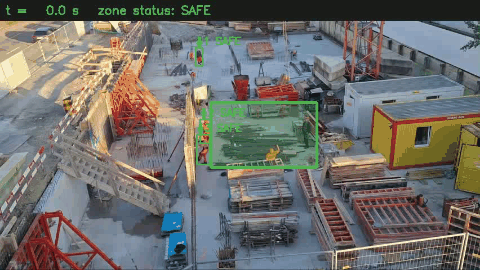
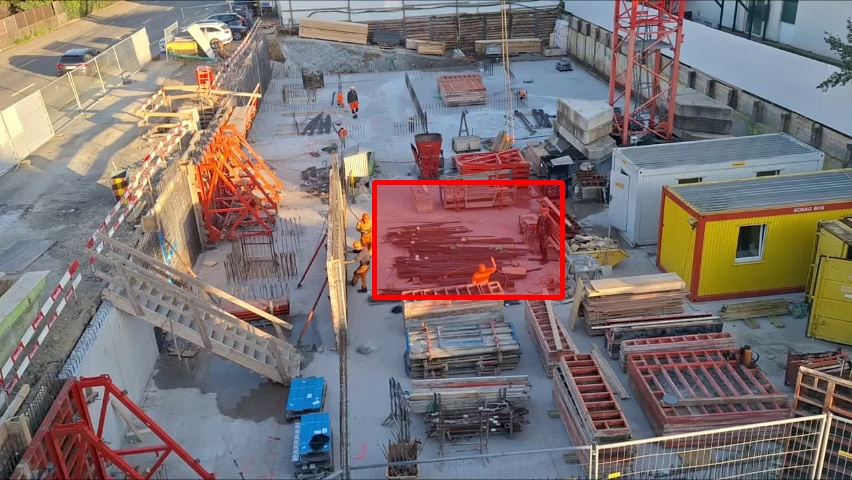
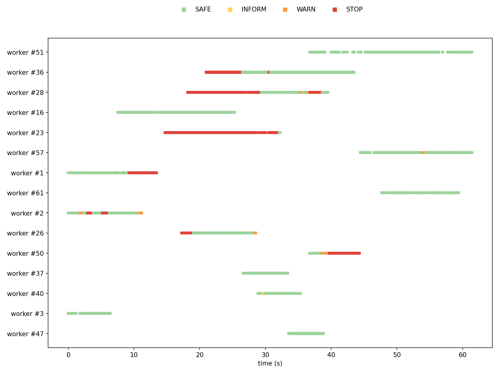
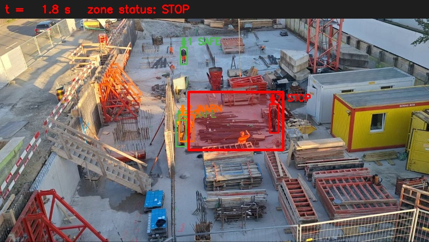

# Worker tracking and movement prediction for crane danger-zone warnings

A computer-vision mini-project on struck-by hazard monitoring. A YOLO detector finds workers in video from a fixed, elevated camera overlooking a construction site with an active tower crane. ByteTrack gives each worker a stable ID across frames. The system estimates each worker's walking velocity, predicts their position a few seconds ahead, and issues a **three-level warning** before they enter a danger zone, here the landing area under the crane's suspended load.



This project extends my [construction PPE detection project](https://github.com/AfzalSiraj/construction-ppe-yolo) from detecting workers to anticipating where they are going.

## How it works

1. **Detect.** A COCO-pretrained YOLO26n model finds people in each frame. Input is upscaled to 1280 px, because workers are small in this view.
2. **Track.** ByteTrack links detections across frames, so each worker keeps the same ID.
3. **Locate.** Each worker's position is the bottom-centre of their bounding box, where their feet meet the ground.
4. **Estimate velocity.** Speed and direction come from the worker's movement over the last 0.5 s, which smooths out box jitter. Movement slower than 15 px/s counts as standing still.
5. **Predict.** A constant-velocity model projects each worker's path up to 5 s ahead, checked every 0.25 s.
6. **Warn.** Each worker is assigned a level:

| Level | Rule |
| --- | --- |
| STOP | The worker is inside the danger zone now |
| WARN | The worker is predicted to enter within 3 s |
| INFORM | The worker is predicted to enter within 5 s |

This tiered approach follows Wong et al. (2023), who proposed graded pre-alerts for tower-crane lifting operations.

## Setup

- **Video:** a 61.5 s real-time clip (852 × 480 px, 30 fps) from a fixed, elevated camera. It shows a site with a tower crane moving a suspended load and about 10 workers in high-visibility clothing.
- **Danger zone:** a rectangle around the area where the crane load is landed and workers handle materials.
- **Hardware:** Tesla T4 GPU in Kaggle Notebooks.



## Results

| Measure | Value |
| --- | --- |
| Frames processed | 1,844 (61.5 s) |
| Worker tracks lasting at least 1 s | 27 |
| Tracks that began inside the zone (entry not observed) | 9 |
| Workers seen walking into the zone | 3 |
| Of these, warned before entering | **3 of 3** |
| Warning lead time | 9.1 s, 1.1 s and 1.1 s (median 1.1 s) |
| Share of frames with the zone at WARN or STOP | 61% |

*Warning lead time is how many seconds before entering the zone a worker first received a WARN or INFORM.*



*Each row is one worker track. The colour shows its warning level over time.*



The per-frame log is in [`results/track_log.csv`](results/track_log.csv) and the per-worker summary is in [`results/worker_summary.csv`](results/worker_summary.csv).

## What I learned

- **Every observed entry was warned in advance.** All 3 workers seen walking into the landing zone received a warning first. But two of the lead times were only about 1 s, too short for a real reaction. Workers on site often move slowly or change direction just before entering, so a constant-velocity prediction picks them up late.
- **Tracking identity is the weak link, not detection.** The camera saw about 10 workers, but the tracker produced 41 IDs (27 lasting at least 1 s). Workers were lost when hidden behind stacked materials or when they crouched, then re-found under a new ID. A third of the tracks (9) began inside the zone, so their entry could not be evaluated. Better re-identification would matter more than a better detector here.
- **Zone status was "busy" 61% of the time.** That is because workers legitimately work inside the landing area. A real system must tell the difference between authorised work in the zone when no load is overhead and exposure while a load is suspended. A fixed zone cannot do that. It needs to know where the load is.
- **Small, distant workers need higher resolution.** At 640 px input, many workers were missed. Upscaling to 1280 px improved detection, at the cost of speed.

## Limitations

- **Everything is in pixels.** Speeds are in pixels per second and depend on the camera's angle and distance. Real distances need camera calibration, which is my next mini-project.
- **The danger zone is fixed.** A real fall zone moves with the crane load and grows with its height. The load itself is not detected here.
- **Constant-velocity prediction is simple.** It cannot anticipate turns, stops or slow approaches.
- **Validation is limited.** This is one short video, and there is no human-annotated ground truth for when each worker truly entered the zone. With only 3 observed entries, the lead-time numbers are illustrative, not statistically meaningful.
- **Earlier test on time-lapse footage:** on a sped-up "tilt-shift" stock clip, tracking broke into very short fragments (91 IDs in 15 s), and prediction failed. Real-time footage is essential.

## How to run it

Open [`worker_tracking_prediction.ipynb`](worker_tracking_prediction.ipynb) in Kaggle Notebooks with GPU and internet turned on. Upload a construction-site video with **Add Input > Upload**, adjust the danger-zone polygon in section 3, and run all cells.

```bash
pip install -r requirements.txt
```

## References

- Wong, P.K.-Y., et al. (2023). Predictive safety monitoring for lifting operations with vision-based crane-worker conflict prediction. *Proc. 23rd CONVR*.
- Zhang, Y., et al. (2022). ByteTrack: Multi-object tracking by associating every detection box. *ECCV 2022*.
- [Ultralytics YOLO](https://github.com/ultralytics/ultralytics) (AGPL-3.0)

Video: [add the source and licence of the clip, e.g. "Pexels, free licence, by <creator>"]

This repository is released under AGPL-3.0, the same licence as Ultralytics.
